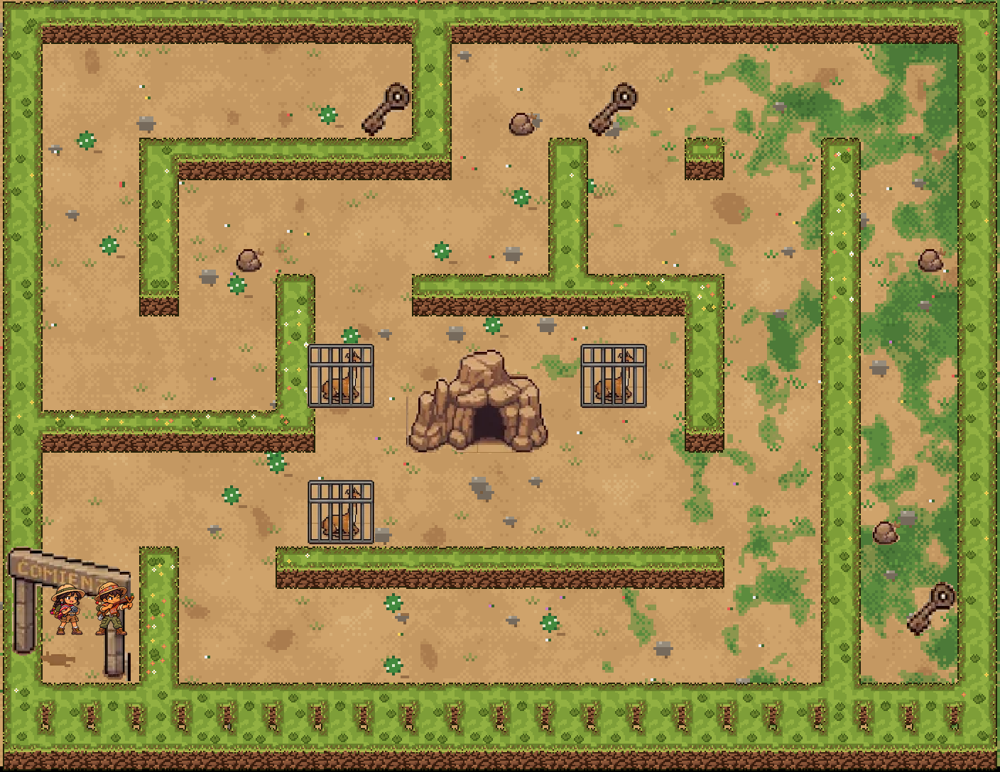

# FAUNA en Construct 3

Cómo está armado el juego y qué tocar para cambiarlo.

## Recorrido del juego

1. **`Inicio`** (*First layout*): pantalla de título **FAUNA** con el mapa de Argentina. Solo la **Puna** está habilitada; las demás zonas tienen candado. Tocar la Puna, tocar **JUGAR** o apretar Enter/Espacio guarda la zona en la variable global **`REGION`** y pasa a `Laberinto`.
2. **`Laberinto`**: cada partida arma un laberinto nuevo (28 × 19 casillas de 64 px) con niebla, llaves, jaulas, cactus, rocas y cazadores. Las jaulas guardan animales sorteados de la región elegida.
3. Al abrir una jaula se ve la animación de huida y después la **ficha del animal** en el centro de la pantalla, con el juego en pausa hasta apretar Espacio o Enter.
4. Al abrir todas las jaulas y cerrar la última ficha, sale un laberinto nuevo. Al perder las 3 vidas se repite el mismo laberinto, con los mismos animales.

Para probar en el editor, abrí el layout que quieras ver y apretá *Preview* (F5): arranca en el layout abierto. El juego exportado arranca siempre en `Inicio`.

`Layout 1` es el nivel hecho a mano del principio. No se juega, pero **no hay que borrarlo**: tiene las instancias que Construct usa como molde para crear por script la cueva, el portal, las jaulas, las llaves, las rocas y los cactus. Las llaves, las jaulas, el cambio de personaje y las vidas también funcionan ahí.

## Controles

- **Flechas:** mover al personaje elegido.
- **Espacio:** cambiar entre **Mafalda** y **Dieguito** (la flecha amarilla marca cuál se maneja y la cámara lo sigue; el otro lo sigue solo).
- **X:** mientras se maneja a Dieguito, tira una piedrita con la onda hacia donde camina (una cada medio segundo). Arriba a la derecha aparece el cartel «X: tirar con la onda».
- **Espacio o Enter:** cerrar la ficha de un animal.
- **Solo Mafalda junta las llaves y abre las jaulas**, y solo mientras se la maneja (siguiendo a Dieguito no hace nada). Al acercarse a una jaula sin poder abrirla, la jaula muestra un globo: «Solo Mafalda puede abrirnos» si se maneja a Dieguito, o «Necesitás una de las llaves para abrirnos» si Mafalda no tiene llaves. **Solo Dieguito tira con la onda.** Así hay que ir cambiando de personaje.
- Caminar contra una roca la salta si del otro lado hay lugar.

## Qué hay en el proyecto

| Dónde | Qué hace |
|---|---|
| `scripts/inicio.js` | pantalla de inicio: la zona y el botón laten, detecta los toques y pasa al laberinto con la región elegida. Las zonas habilitadas están en `ZONAS` |
| `scripts/generadorLaberinto.js` | `generarMapa(opciones)`: arma el laberinto como texto (ver [El mapa como texto](#el-mapa-como-texto)) |
| `scripts/construirLaberinto.js` | `construirLaberinto(runtime, mapa)`: pinta los muros en el `Tilemap`, crea los objetos de cada letra con su tamaño, pone a Mafalda y a Dieguito delante del portal y regenera el mapa del *Pathfinding* |
| `scripts/personajes.js` | movimiento, cambio de personaje con Espacio, el que sigue con *Pathfinding*, espejado según hacia dónde caminan, vidas (un cactus o un cazador resta una y los dos vuelven al portal, parpadeando 1,5 s sin poder perder otra) y corazones del HUD |
| `scripts/cazadores.js` | cada cazador va y viene por un tramo corto de su pasillo; cada 3–6 s se esconde entre los setos y aparece en otro punto. Si el personaje manejado se le acerca a menos de 44 px mientras se ve, pierde una vida. Escondido no hace daño |
| `scripts/onda.js` | la onda de Dieguito: la piedrita vuela hasta 420 px, pasa por encima de las rocas, se frena en muros y cactus y derriba al cazador que toque si se lo ve (no sirve contra uno escondido). El cazador derribado cae y no vuelve en ese laberinto |
| `scripts/cartelJaula.js` | el globo `spriteCartelJaula` (capa `Niebla`) sobre la jaula más cercana cuando el personaje manejado está a menos de 40 px y no puede abrirla. Cada texto es una animación del globo: `solo_mafalda` y `necesita_llave` |
| `scripts/saltoRoca.js` | salto en arco de 0,4 s por encima de una roca |
| `scripts/niebla.js` | el `Tilemap` **Niebla** (casillas de 32 px) tapa el mapa y se despeja para siempre alrededor de los personajes. `RADIO` cambia cuánto se ve |
| `scripts/fichas.js` | sorteo de animales por laberinto y ficha del animal rescatado (ver [Sumar un animal](#sumar-un-animal)) |
| `scripts/importsForEvents.js` | nombre especial de Construct: lo que importa se puede usar en los bloques de script de las hojas de eventos |
| hoja `Inicio` | variable `REGION` (texto, `"puna"`); llama a `inicio.js` al empezar, en cada tick y con Enter/Espacio |
| hoja `Event sheet 1` | variables `LLAVES`, `VIDAS`, `FICHA` y `PERSONAJE` (texto: quién se maneja, `"Mafalda"` o `"Dieguito"`); llama a `personajes.js` y a `fichas.js` (X dispara la onda); las llaves las junta Mafalda si `PERSONAJE` = `"Mafalda"` (*Is overlapping*, así también la levanta si se cambia a ella estando encima); las jaulas igual, con `LLAVES` ≥ 1 (cada llave abre una sola jaula) |
| hoja `Laberinto` | incluye `Event sheet 1`; variable `SEMILLA`; arma el laberinto al empezar y pasa a uno nuevo al abrir todas las jaulas |
| layout `Laberinto` | 1792 × 1216. Capas: `BG` (fondo), `Layer 1` (`Tilemap` con **Solid**, personajes y moldes fuera de pantalla de `spriteHuida`, `spriteCazador` y `spritePiedrita`), `Niebla` (niebla y flecha) y `HUD` (paralaje 0: corazones y ficha) |

Los objetos están ordenados en carpetas del panel *Project*: `inicio` (fondo, zona y botón de la pantalla de inicio), `personajes` (Mafalda, Dieguito y la piedrita de la onda), `muros_y_tiles` (muros, fondo, niebla, rocas y cactus), `animales_libres` (animación de huida y fichas de los animales), `cazadores`, `jaulas_y_metas` (jaulas, llave, cueva, portal) e `interfaz` (corazones, flecha, velo, cartel de la ficha, cartel de la onda y globo de las jaulas). En disco, cada objeto está en `objectTypes/<carpeta>/`. Las imágenes las maneja Construct en `images/` con el nombre del objeto; no se mueven a mano.

## Cambiar el laberinto

El script de *On start of layout* de la hoja `Laberinto`:

```js
const JAULAS = 3;
if (!runtime.globalVars.SEMILLA)
	runtime.globalVars.SEMILLA = Math.floor(Math.random() * 1e9) + 1;
const mapa = generarMapa({ jaulas: JAULAS, semilla: runtime.globalVars.SEMILLA });
construirLaberinto(runtime, mapa);
elegirAnimales(runtime.globalVars.REGION, runtime.globalVars.SEMILLA, JAULAS);
```

Para cambiar la cantidad de jaulas, cambiá `JAULAS`. Las demás opciones se suman al objeto que recibe `generarMapa`, por ejemplo `generarMapa({ jaulas: JAULAS, cactus: 5, semilla: ... })`. Todas son opcionales:

| Opción | Por defecto | Qué hace |
|---|---|---|
| `jaulas` | 3 | jaulas y llaves (de 1 a 5) |
| `rocas` | 6 | rocas sueltas |
| `cactus` | 4 | cactus, si hay callejones libres (solo van en callejones porque tapan todo el pasillo) |
| `cazadores` | 4 | cazadores en pasillos, a 4 casillas o más del inicio y separados entre sí |
| `entradasSala` | 3 | entradas a la sala del medio |
| `bucles` | 0.06 | probabilidad de abrir un muro extra; más alto = más caminos alternativos |
| `estilos` | `"##FS"` | letras de muro para el interior (repetir una letra la hace más común) |
| `estiloBorde` | `"#"` | letra del borde del mapa |
| `ancho`, `alto` | 28, 19 | tamaño en casillas; conviene 1 + múltiplo de 3. Si lo cambiás, cambiá también el tamaño del `Tilemap`, de la niebla, del fondo y del layout (casillas × 64 px) |
| `semilla` | al azar | el mismo número da siempre el mismo laberinto |

Para jugar siempre **un laberinto fijo**, poné un número en la variable `SEMILLA` (por ejemplo `127492926`) en vez de `0`.

Qué genera siempre: pasillos de 2 casillas de ancho (en 1 casilla los personajes no pasan), una sala en el medio con la cueva y las jaulas, tantas llaves como jaulas escondidas en callejones lejos del inicio, cactus que nunca tapan un camino y el portal con los personajes en la esquina de abajo a la izquierda.



Para ver laberintos sin abrir Construct:

```
node scripts/construct_laberinto/generador/vista_previa.mjs [semilla] [jaulas]
```

## El mapa como texto

`generarMapa` devuelve el laberinto como un texto con las filas separadas por `|`. Un punto (`.`) es camino y cada letra es un muro o un objeto:

| Letra | Qué es | Objeto | Tamaño |
|---|---|---|---|
| `#` `F` `S` `Y` `P` `R` | muro: seto verde, florido, seco puna, yunga, piedra gris, piedra rojiza | tile del `Tilemap` | 64 × 64 |
| `K` | cactus | `spriteSaguaro` | 80 × 130 |
| `O` | roca | `spriteRock` | 40 × 34 |
| `V` | cueva | `spriteCueva` | 200 × 150 |
| `G` | portal de inicio | `spritePortal` | 176 × 190 |
| `J` | jaula | `spriteJaula` | 96 × 92 |
| `L` | llave | `Sprite2` | 70 × 76 |
| `H` | cazador (`Cazador1` o `Cazador2` al azar) | `spriteCazador` | 48 × 72 |
| `E` `N` | Mafalda y Dieguito (se mueven, no se crean) | `spriteMafalda`, `spriteDieguito` | los del layout |

Los tamaños están en `OBJETOS`, al principio de `construirLaberinto.js`: un objeto creado por script usa el tamaño de su imagen, y las imágenes tienen tamaños muy distintos.

Los muros usan `tileset_muros_noa_64.png` (tiles de 64 × 64). **Número de tile = máscara + estilo × 16 + variante × 96**:

- **Máscara (0–15):** suma de los vecinos que también son muro: norte = 1, este = 2, sur = 4, oeste = 8. Así cada pieza conecta con sus vecinas.
- **Estilo (0–5):** el orden de las letras de muro de la tabla (`#` = 0 … `R` = 5).
- **Variante (0–2):** se elige al azar para que los setos no se vean todos iguales.

En `guia_indices.png` está el número de cada tile.

## Sumar un animal

Cada ficha es una animación de `spriteFichaAnimal` llamada **`region_animal`**, en minúscula y sin tildes (`puna_vicuna`, `puna_zorro_andino`, `chaco_quirquincho_bola`). Las fichas miden 1024 × 1536.

1. Poné la imagen en `images/` con el nombre `spritefichaanimal-region_animal-000.png` (por ejemplo `spritefichaanimal-puna_taruca-000.png`), o importala en Construct en una animación nueva `puna_taruca` de `spriteFichaAnimal`.
2. Sumá `"taruca"` a la lista de su región en `ANIMALES`, al principio de `scripts/fichas.js`.

Cada laberinto **sortea qué animales de su región están en sus jaulas**: uno por jaula, sin repetir mientras alcancen. Si la región tiene más animales que jaulas, algunos no aparecen en ese laberinto; si tiene menos, se repiten. Nunca aparece un animal de otra región.

## Habilitar otra zona

En la pantalla de inicio, cada zona habilitada es un sprite recortado del fondo (`spriteZonaPuna`) puesto justo encima de su lugar en el mapa; las zonas con candado son parte del dibujo de `spriteInicioFondo`.

1. Recortá la zona del fondo (sin candado) en un sprite nuevo, por ejemplo `spriteZonaChaco`, y ponelo en el layout `Inicio` encima de su lugar.
2. Sumalo a `ZONAS` en `scripts/inicio.js`: `spriteZonaChaco: "chaco"`.
3. Sumá los animales de esa región a `ANIMALES` en `scripts/fichas.js`.
